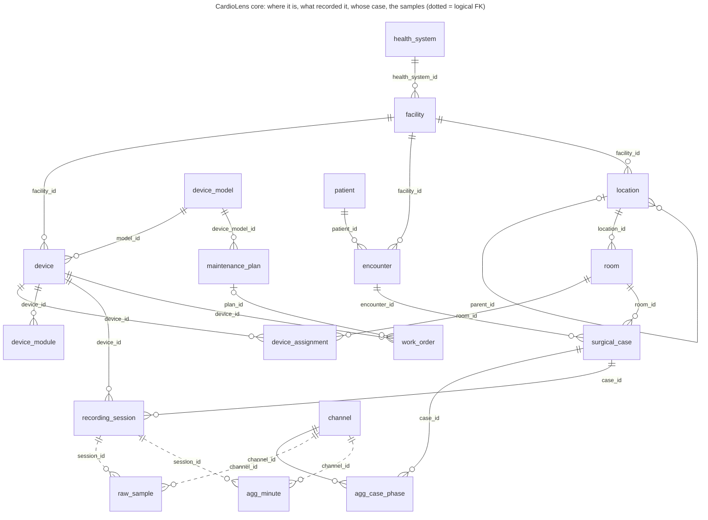
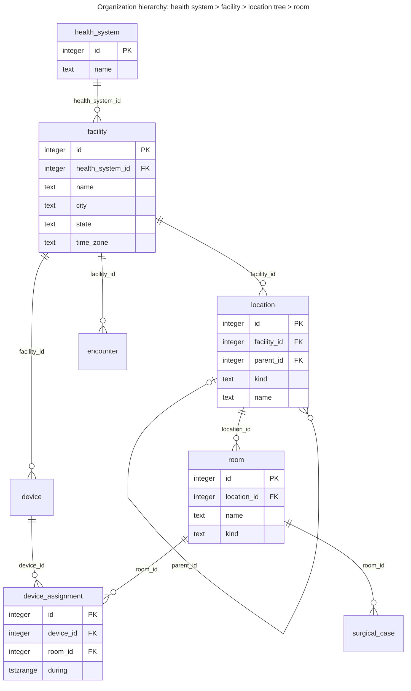
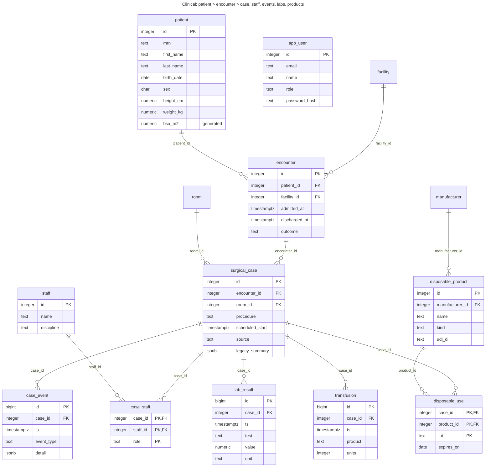
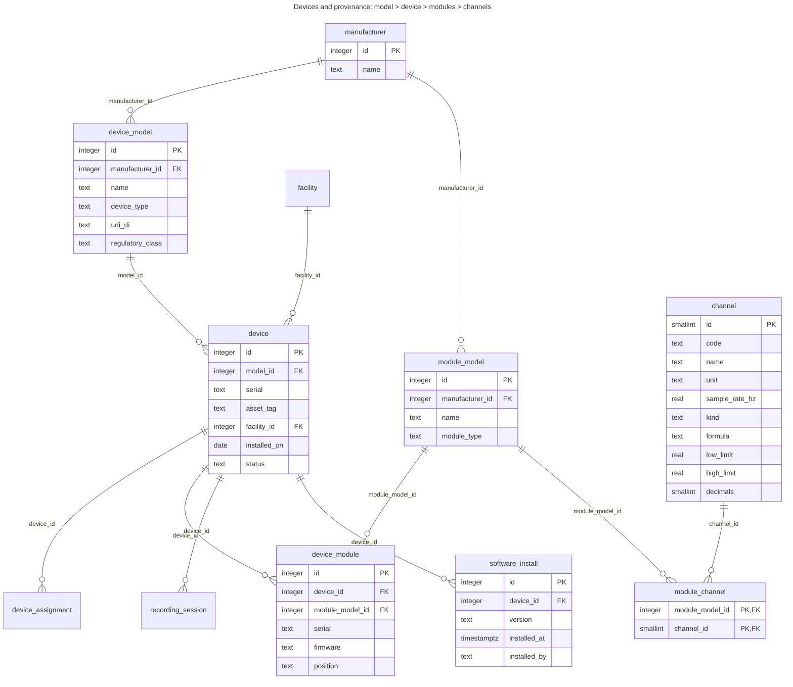
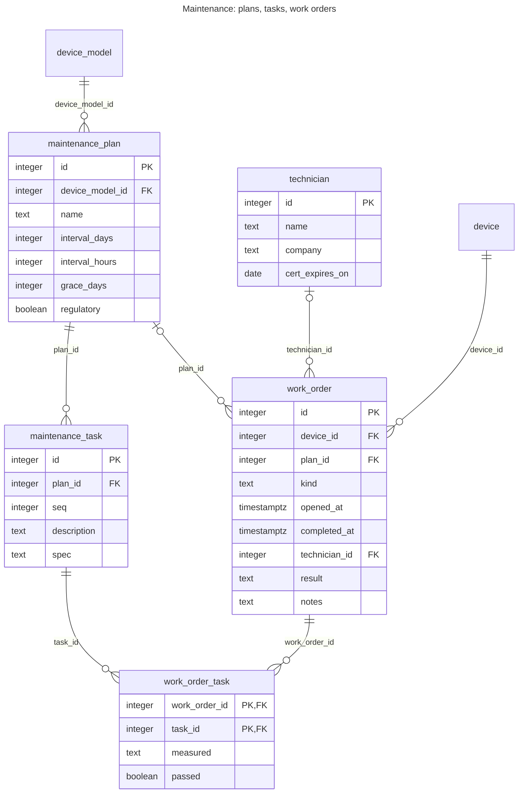
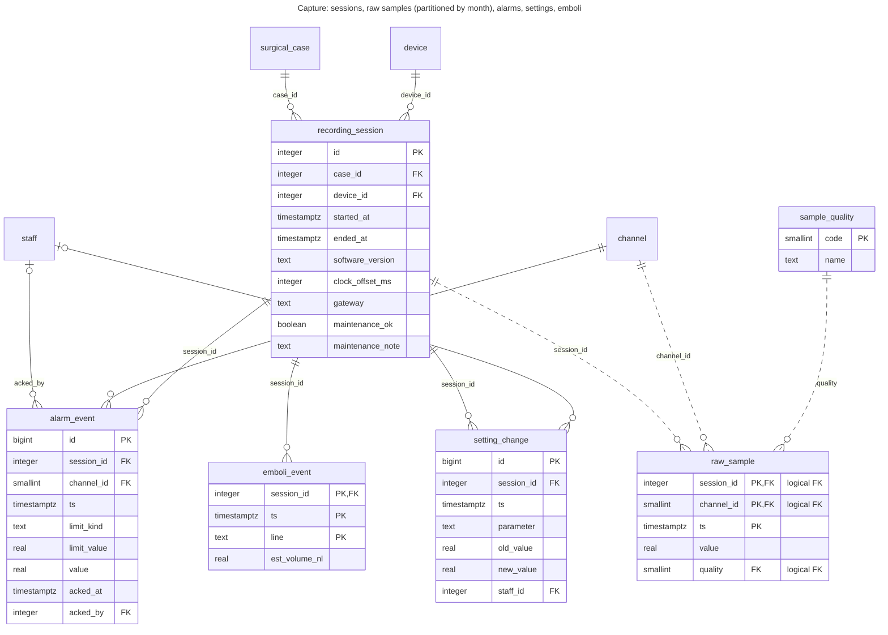
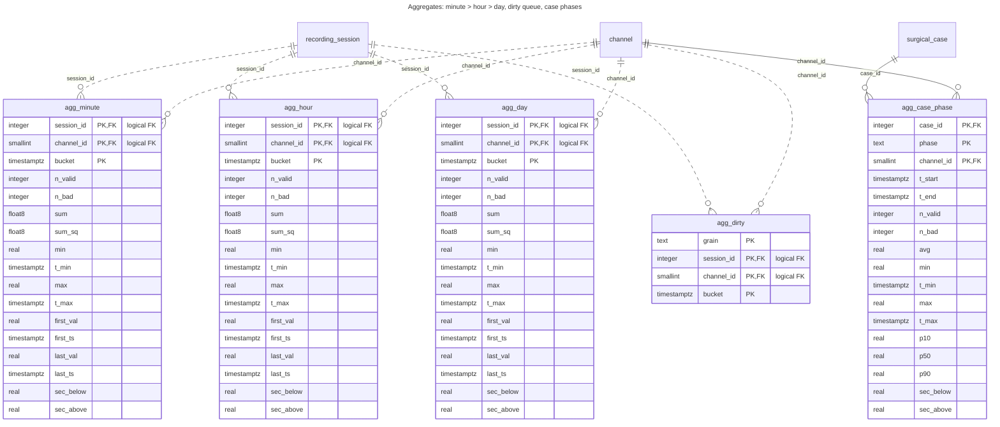

# CardioLens data model

Generated from the live `cardiolens` schema by `npm run db:erd`: 40 tables, 44 declared foreign keys,
11 logical ones. Solid lines are declared foreign keys. Dotted lines are relationships the high-volume tables
deliberately don't declare: raw samples and aggregates are written only through `ingest_samples()`, and an FK check per row
costs more than it protects. Rendered copies are in [docs/erd/](erd/).

## Overview

## Organization

## Clinical

## Devices

## Maintenance

## Capture

## Aggregates

